# Store Frontend — E-commerce Storefront

**Live demo:** [store-frontend-flame.vercel.app](https://store-frontend-flame.vercel.app/)

## Screenshots

Captured from the deployed site while logged in as a demo customer.

### Home

| Light | Dark |
|---|---|
| 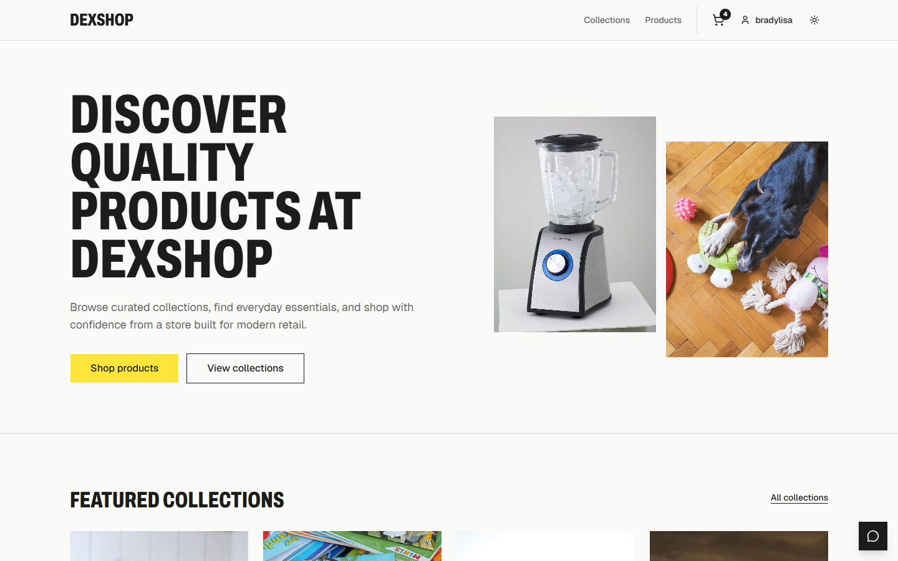 | 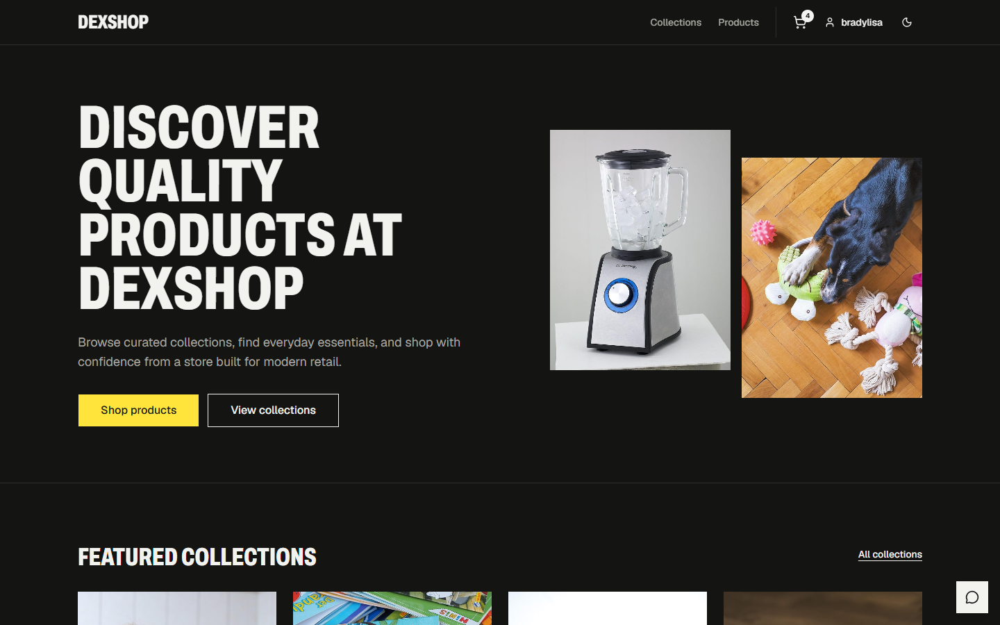 |

### Shopping

| Products | Product detail |
|---|---|
| 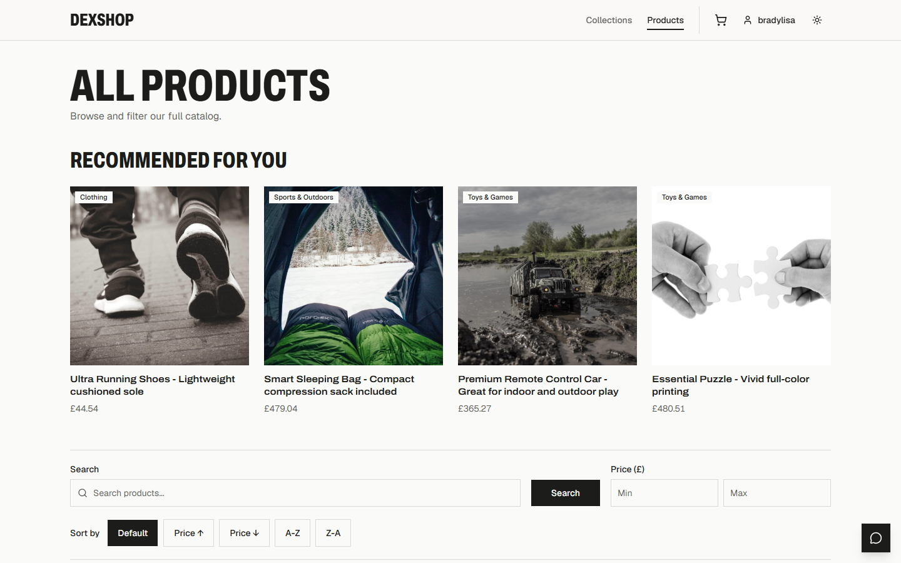 | 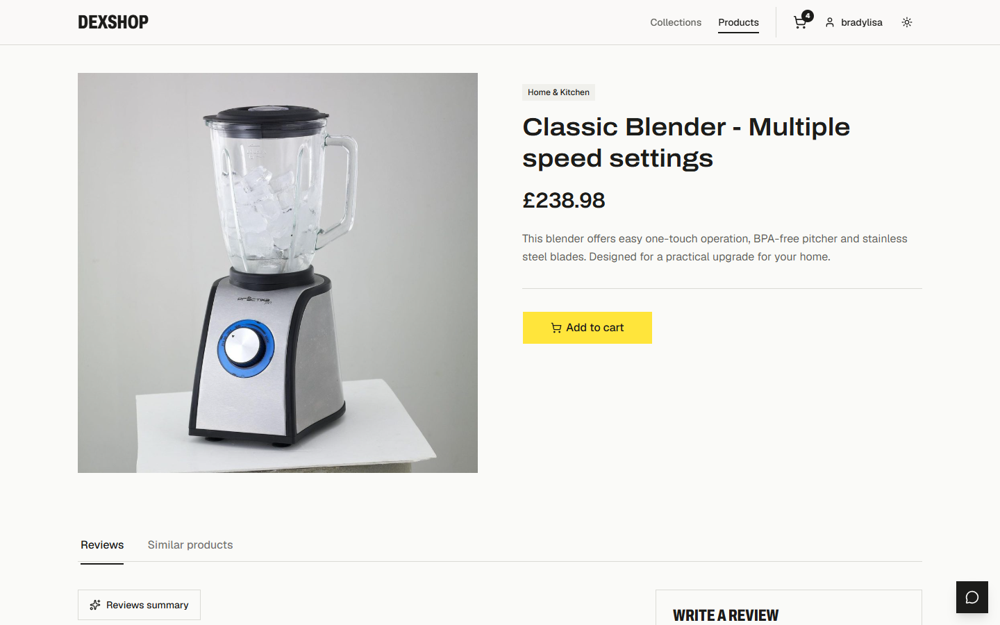 |

| Collections | Cart |
|---|---|
|  | 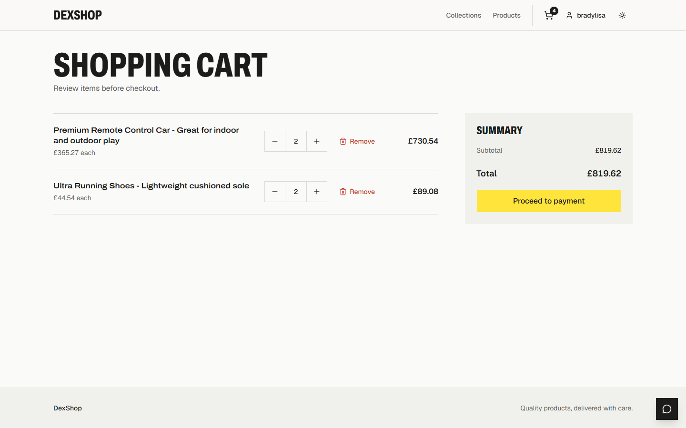 |

### Reviews and recommendations

| AI review summary | Similar products |
|---|---|
| 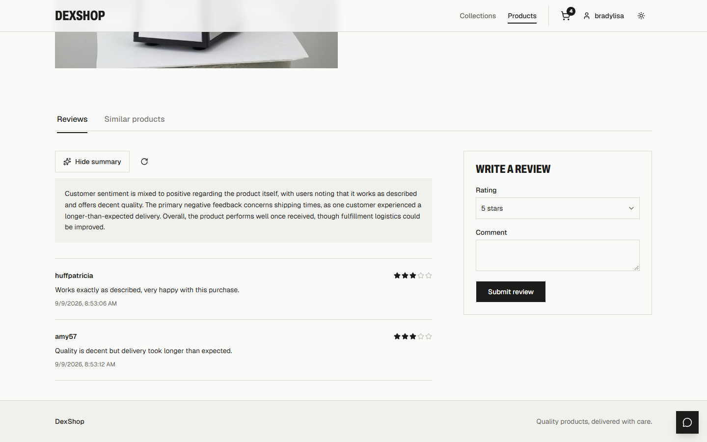 | 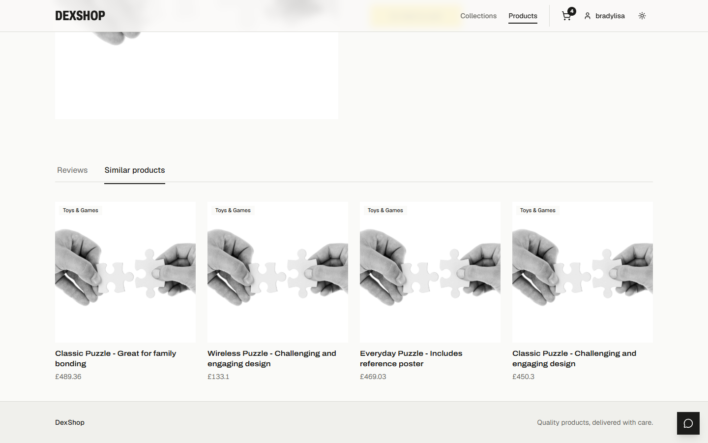 |

### AI shopping assistant

| Desktop | Mobile |
|---|---|
| 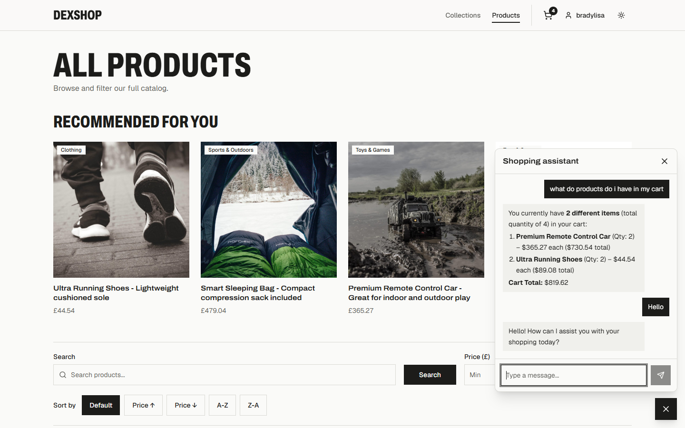 | 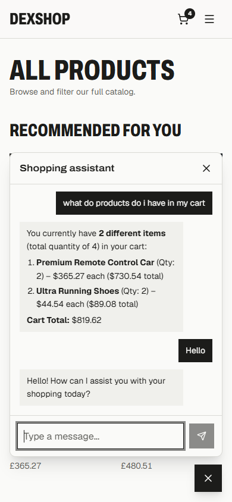 |

### Account

| Login | Profile |
|---|---|
| 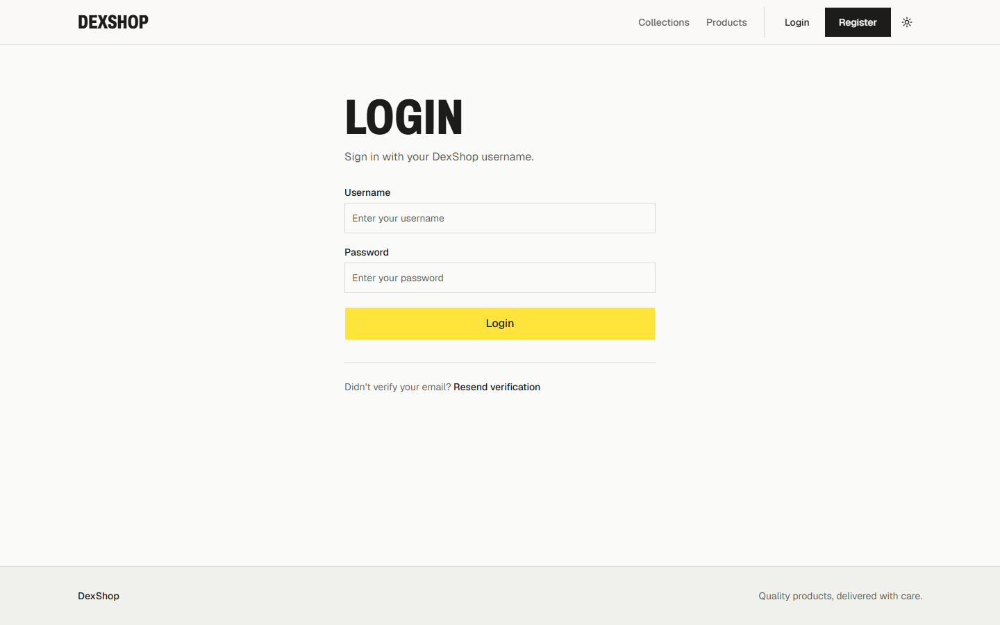 | 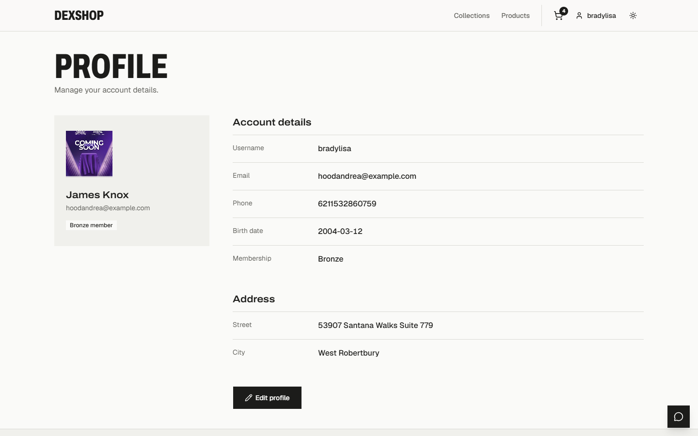 |

| Order detail |
|---|
| 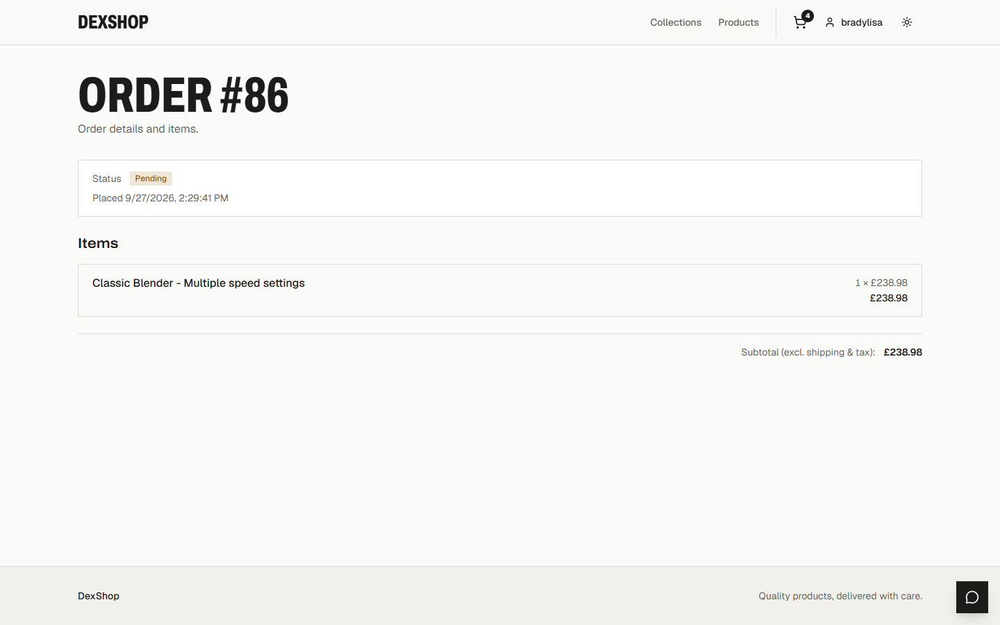 |

### Mobile

| Home | Product | Cart |
|---|---|---|
| 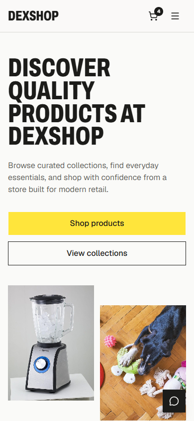 | 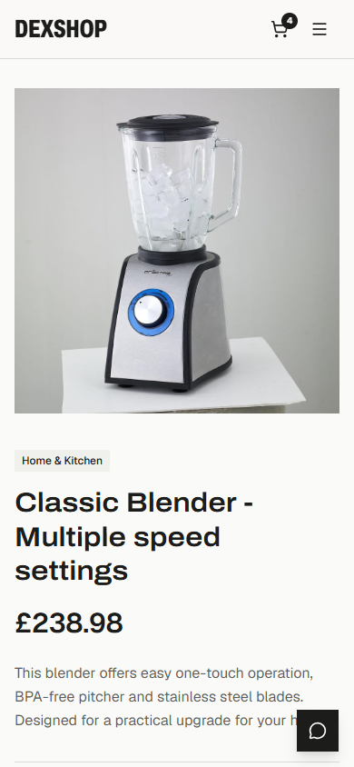 | 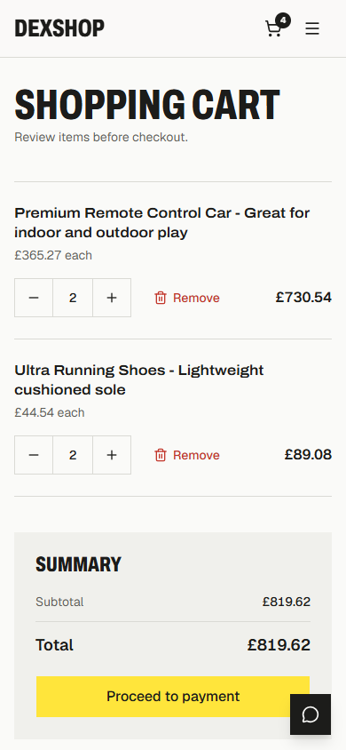 |

## 1. Project Overview

This is a React + TypeScript single-page application implementing an e-commerce storefront ("DexShop" — the brand name used in the UI, e.g. `Navbar.tsx`), plus a staff-only admin back-office, both served from the same app. It communicates with a separate Django REST Framework backend (see the sibling `store` project) over HTTP.

Customer-facing features:
- Browsing collections and paginated/filterable products, with product detail pages showing reviews, AI-generated review summaries, and "similar products"
- Cart management and a simulated checkout/payment flow, plus order history
- Account registration with email activation, login, and profile management (including address and profile image)
- A floating AI shopping-assistant chatbot widget with streaming responses, visible to logged-in users

Admin features (under `/admin/*`, staff-only):
- Dashboard with revenue/order charts and KPI cards
- Product CRUD with image upload/removal
- Collection CRUD (including a "featured product")
- Order list/detail with payment-status management
- Customer list/detail with membership-tier management

> Note: the checkout on `/payment` is an explicitly simulated flow (the UI text says "TEST MODE — no real payment will be made"). There is no real payment gateway integrated (no Stripe/PayPal SDK is present in `package.json`).

## 2. Tech Stack

**Core**
- React 19, TypeScript, Vite 8 (`@vitejs/plugin-react`)
- Routing: React Router 7 (`createBrowserRouter` / `RouterProvider`)

**State / data**
- TanStack Query 5 — the sole server-state layer (no Redux/Zustand)
- React Context — used only for authentication/user state
- TanStack Table — installed, used in a data-table component

**UI**
- shadcn/ui component system (`components.json`, style `radix-nova`) built on Radix UI primitives, `cmdk`, `vaul` (drawer), `sonner` (toasts)
- Tailwind CSS v4 (CSS-first config — no `tailwind.config.js`; theme lives in `src/index.css`)
- Bootstrap 5 CSS/JS is also loaded globally and used for a few simpler pages (Payment, Activate Account, Resend Verification) — a known styling inconsistency, not a deliberate two-system design
- Icons: lucide-react · Charts: Recharts (admin dashboard) · Theming: next-themes (light/dark/system) · Font: Fontsource Geist Variable
- Drag-and-drop: `@dnd-kit/*` packages are installed but not confirmed to be wired into any page

**Forms & validation**
- React Hook Form, with Zod validation used in some newer forms (admin login, admin products) but not others (login/register use plain React Hook Form)

**HTTP**
- Axios (single shared instance) for all REST calls
- Raw `fetch` with manual stream reading, used only for the streaming chatbot endpoint

**Dev tooling**
- ESLint 10 (flat config) with `typescript-eslint`, `eslint-plugin-react-hooks`, `eslint-plugin-react-refresh`
- `shadcn` CLI (used to pull in UI components)

## 3. Architecture

```
Page component → resource-specific hook (useX) → api/x.ts function → shared axios client → backend
```

- **`src/api/`** — one file per backend resource; thin functions that call the shared Axios instance and return typed responses. No business logic here.
- **`src/hooks/`** — one file per resource, wrapping `api/` functions in TanStack Query `useQuery`/`useMutation` hooks (cache keys, invalidation). This is the layer pages actually consume. A few auth-related pages (login, register, activation) call `api/auth.ts` directly since login/registration isn't cached server state.
- **`src/types/`** — TypeScript interfaces per domain (auth, cart, order, customer, address, chatbot, recommendation) plus a shared `index.ts` (Product, Collection, Review, pagination types).
- **`src/context/AuthContext.tsx`** — the only React Context; holds the logged-in user and loading state, exposed via `useAuth()`.
- **`src/pages/`** — one folder per route/screen; admin pages live under `pages/Admin/`.
- **`src/components/`** — shared presentational/composite components (Navbar, Layout, AdminLayout, ProductCard, Chatbot, ReviewForm/List, Pagination, etc.), plus `components/ui/` — the shadcn/ui primitive library.
- **`src/lib/`** — `utils.ts` (the shadcn `cn()` class-merging helper) and `Store.ts`. **Note:** despite its name, `Store.ts` is *not* a state store — it only holds shared Tailwind class-name string constants (e.g. `pageContainer`, `pageTitle`).
- **`src/router.tsx`** — the centralized route table.
- **`src/main.tsx`** — app bootstrap and provider composition (QueryClientProvider, ThemeProvider, TooltipProvider).

## 4. Routing

All routes are defined in `src/router.tsx` via `createBrowserRouter`.

**Public/customer routes** (wrapped in `<Layout>`, which renders the Navbar, page content, and the floating Chatbot):

| Path | Page |
|---|---|
| `/` | Home |
| `/products` | Products |
| `/products/:id` | ProductDetail |
| `/register` | Register |
| `/login` | Login |
| `/collections` | Collections |
| `/collections/:id` | CollectionDetail |
| `/cart` | Cart |
| `/orders` | Orders |
| `/orders/:id` | OrderDetail |
| `/profile` | ProfilePage |
| `/payment` | PaymentPage |
| `/activate/:uid/:token` | ActivateAccount |
| `/resend-verification` | ResendVerification |

**Admin routes:**

| Path | Page |
|---|---|
| `/admin/login` | AdminLogin (outside the protected wrapper) |
| `/admin/` | Redirects to `/admin/dashboard` |
| `/admin/dashboard` | DashboardPage |
| `/admin/products` | AdminProducts |
| `/admin/collections` | AdminCollections |
| `/admin/orders` | AdminOrders |
| `/admin/customers` | AdminCustomers |

**Route protection**: The admin tree (excluding `/admin/login`) is wrapped in an `AdminRoute` guard that reads `{ user, isLoading }` from `useAuth()`. It renders nothing while loading, redirects to `/admin/login` if there's no user or `user.is_staff` is false, and otherwise renders the admin layout and its children.

There is **no router-level guard on customer-only pages** (Cart, Orders, Profile, Payment) — those pages individually check `useAuth().user` and render a "please log in" state instead of redirecting.

## 5. State Management

- **Server state** — TanStack Query, via a single `QueryClient` provided app-wide in `main.tsx`. Nearly all backend-derived data (products, collections, cart, orders, customers, reviews, addresses, recommendations, chat history, admin dashboard stats) flows through per-resource hooks in `src/hooks/`, using query keys like `["products", params]`, `["cart"]`, `["orders"]`, `["order", id]`, etc. Mutations call `invalidateQueries` on success to refresh dependent data (e.g. creating an order invalidates both `["orders"]` and `["cart"]`).
- **Auth/user state** — `AuthContext` (`src/context/AuthContext.tsx`). Holds `user` and `isLoading` in local state; on mount, if an access token exists in `localStorage`, it fetches the current user to hydrate the context, clearing tokens on failure.
- **Local/UI state** — plain `useState` for forms, dialogs, filters, pagination, and chat messages.
- **Cart is server-backed, not client-side** — `useCart()` fetches `/cart/` (only when a user is logged in), and add/update/delete mutations hit the backend and invalidate the `["cart"]` query. There is no local cart persisted in the browser.

## 6. API Integration

All backend calls go through a single Axios instance (`src/api/client.ts`):

```ts
const client = axios.create({ baseURL: import.meta.env.VITE_API_URL });
```

- **Request interceptor** attaches `Authorization: JWT <access>` (note: `JWT`, not `Bearer`, to match the backend's SimpleJWT header config) from `localStorage` to every request, except a hard-coded whitelist of public auth endpoints (register, login, refresh, activation, resend-activation).
- **Response interceptor** catches a `401`, attempts a token refresh via `/auth/jwt/refresh/` using the stored refresh token, retries the original request once, and clears both tokens if refresh fails.

Resource modules under `src/api/` and the backend endpoints they call:

| File | Endpoints |
|---|---|
| `auth.ts` | `POST /auth/users/`, `POST /auth/jwt/create/`, `GET /auth/users/me/`, `POST /auth/users/activation/`, `POST /auth/users/resend_activation/` |
| `products.ts` | `GET/POST/PATCH/DELETE /products/`, `/products/:id/` |
| `productimage.ts` | `POST /products/:id/images/`, `DELETE /products/:id/images/:imageId/` |
| `collections.ts` | `GET /collections/` |
| `admincollections.ts` | `GET/POST /admin-collections/`, `PATCH/DELETE /admin-collections/:id/` |
| `cart.ts` | `GET /cart/`, `POST/PATCH/DELETE /cart-items/` |
| `orders.ts` | `GET/POST/PATCH /orders/`, `/orders/:id/` |
| `customers.ts` | `GET/PATCH /customers/me/`, `GET/PATCH /customers/` |
| `address.ts` | `GET/POST /addresses/`, `PUT/DELETE /addresses/:id/` |
| `reviews.ts` | `GET/POST/PATCH /products/:id/reviews/`, `/reviews/:reviewId/` |
| `reviewsummary.ts` | `GET /products/:id/summary/` |
| `recommendation.ts` | `GET /products/:id/similar/`, `GET /recommendations/` |
| `chatbot.ts` | `POST/GET /chat/`, `POST /chat/stream/` (raw `fetch`, manual stream reading) |

The endpoint shapes (`/auth/users/`, `/auth/jwt/create/`, `/auth/jwt/refresh/`, `/auth/users/activation/`) match a Djoser + SimpleJWT backend, which the sibling `store` project confirms.

## 7. Authentication Flow

- **Login** (`Login.tsx`, and separately `AdminLogin.tsx` for staff): calls `POST /auth/jwt/create/`, stores `access`/`refresh` tokens in `localStorage`, then fetches the current user and stores it in `AuthContext`. `AdminLogin` additionally rejects non-staff accounts.
- **Register** (`Register.tsx`): calls `POST /auth/users/`, then prompts the user to check their email and redirects to `/login` (no auto-login).
- **Email activation**: `/activate/:uid/:token` calls `POST /auth/users/activation/`; `/resend-verification` calls `POST /auth/users/resend_activation/`.
- **Token storage**: plain `localStorage`, keys `"access"` and `"refresh"`.
- **Header attachment / refresh**: centralized in the Axios interceptors in `src/api/client.ts` (see above). The one exception is the streaming chatbot call, which uses raw `fetch` and manually attaches the token — it does **not** benefit from the automatic 401-refresh-retry logic.
- **Auth context**: `AuthContext` / `useAuth()` rehydrates the user from a stored access token on app load.
- **Logout**: implemented ad hoc in `Navbar.tsx` — clears both tokens from `localStorage`, clears the auth context, and navigates to `/login`. There is no dedicated `logout()` function in `AuthContext` itself.
- **Protected routes**: only the admin section has a router-level guard (`AdminRoute`). Customer pages that require auth check `useAuth().user` inline instead of redirecting.
- **Token refresh**: a single retry-on-401 in the Axios response interceptor; there is no proactive/silent background refresh.

## 8. Environment Variables

Only one environment variable is used anywhere in the code:

| Variable | Purpose |
|---|---|
| `VITE_API_URL` | Base URL of the backend API (no trailing slash), consumed via `import.meta.env.VITE_API_URL` in `src/api/client.ts` (Axios `baseURL` and the token-refresh call) and `src/api/chatbot.ts` (the streaming fetch URL). |

`.env.example`:
```
# Copy this file to .env and fill in real values. Never commit .env itself.

# Base URL of the deployed backend API, no trailing slash.
# Local dev example: http://127.0.0.1:8000
# Production example: https://api.example.com
VITE_API_URL=http://127.0.0.1:8000
```

## 9. Local Setup

```bash
npm install
cp .env.example .env    # then set VITE_API_URL to point at your running backend
npm run dev              # starts the Vite dev server (default port 5173)
```

Other available scripts (from `package.json`):

```bash
npm run build     # type-checks via `tsc -b`, then builds a production bundle with Vite
npm run lint       # runs ESLint over the project
npm run preview    # serves the built dist/ folder locally
```

`vite.config.ts` registers only the React and Tailwind plugins and a `@` → `./src` path alias. There is no dev-server proxy configured, so the backend must have CORS enabled for the Vite dev origin (the backend's default `CORS_ALLOWED_ORIGINS` is `http://localhost:5173`, matching Vite's default port).

## 10. Deployment

**No deployment-specific tooling exists in this repository.** Specifically absent: `vercel.json`, `netlify.toml`, `Dockerfile`, and any `.github/workflows` CI/CD configuration. `vite.config.ts` uses no custom `base` path or build options — output goes to `dist/` with the default `/` base.

A `dist/` folder exists in the working tree, but it is a locally generated build artifact (via `npm run build`) and is listed in `.gitignore` — not a checked-in deployment configuration. There is no evidence in the codebase of how or where this app is actually deployed; deploying it would mean running `npm run build` and serving the resulting `dist/` folder via whatever static host is chosen, with `VITE_API_URL` set to the production backend URL at build time.

## 11. Folder Structure

```
store-frontend/
├── .env.example
├── components.json           # shadcn/ui config
├── eslint.config.js
├── index.html
├── package.json
├── public/
│   ├── default.jpg
│   ├── favicon.svg
│   └── icons.svg
├── src/
│   ├── main.tsx
│   ├── router.tsx
│   ├── index.css
│   ├── api/                   # client.ts + one file per backend resource
│   ├── app/dashboard/
│   │   └── data.json           # unused leftover sample data
│   ├── assets/
│   │   └── hero.png
│   ├── components/
│   │   ├── Navbar.tsx, Layout.tsx, AdminLayout.tsx
│   │   ├── ProductCard.tsx, CollectionCard.tsx, Pagination.tsx
│   │   ├── Chatbot.tsx, ChatMessageContent.tsx
│   │   ├── ReviewForm.tsx, ReviewList.tsx
│   │   ├── RecommendedProducts.tsx, SimilarProducts.tsx
│   │   ├── ThemeProvider.tsx, theme-toggle.tsx
│   │   ├── app-sidebar.tsx, site-header.tsx, nav-*.tsx (admin dashboard chrome)
│   │   ├── chart-area-interactive.tsx, section-cards.tsx, data-table.tsx
│   │   └── ui/                 # shadcn/ui primitives (button, card, dialog, table, sidebar, ...)
│   ├── context/
│   │   └── AuthContext.tsx
│   ├── hooks/                 # one useX.ts hook per resource (products, cart, orders, customers, ...)
│   ├── lib/
│   │   ├── Store.ts            # shared Tailwind class-name constants (NOT a state store)
│   │   └── utils.ts            # cn() helper
│   ├── pages/
│   │   ├── Home/, Products/, ProductDetail/, Collections/, CollectionDetail/
│   │   ├── Cart/, Orders.tsx/, OrderDetail/, Payment/, ProfilePage/
│   │   ├── Login/, Register/, ActivateAccount/, ResendVerification/
│   │   └── Admin/               # AdminLogin, DashboardPage, AdminProducts, AdminCollections,
│   │                              # AdminOrders, AdminCustomers, Adminroute.tsx (route guard)
│   └── types/                  # auth, cart, order, customer, address, chatbot, recommendation, index
├── tsconfig.json / tsconfig.app.json / tsconfig.node.json
└── vite.config.ts
```

(`node_modules/`, `dist/`, `.git/` omitted for clarity.)

### Known inconsistencies worth being aware of
- `src/lib/Store.ts` is named like a state store but only exports Tailwind class-name string constants.
- `src/pages/Orders.tsx/` is a folder literally named `Orders.tsx` (containing `Orders.tsx`) — likely an accidental naming artifact rather than intentional.
- `src/assets/react.svg`, `vite.svg`, and `src/app/dashboard/data.json` appear to be unused leftovers from project scaffolding.
- The app mixes Tailwind/shadcn styling with Bootstrap classes on a few pages (Payment, ActivateAccount, ResendVerification) rather than using one system consistently.
